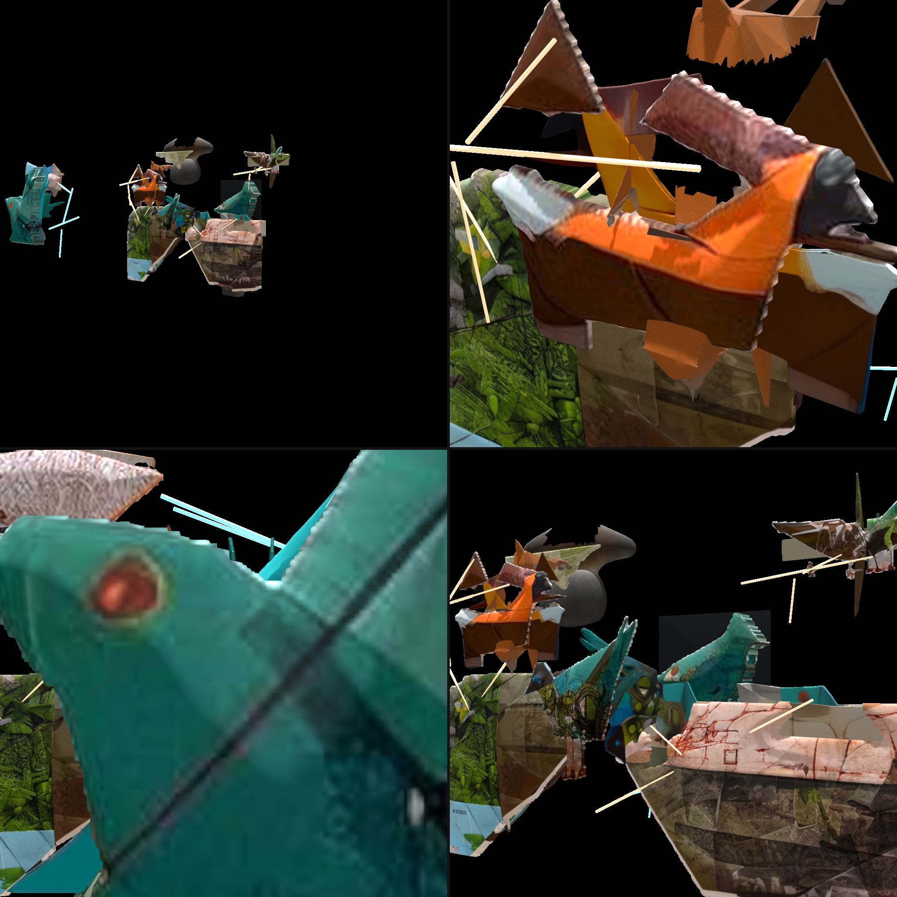
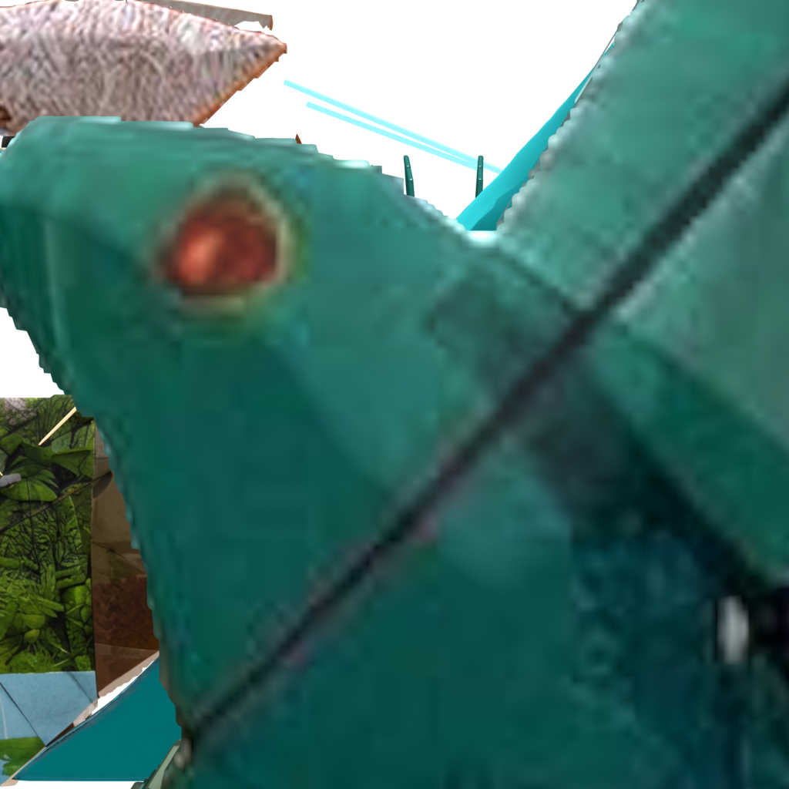
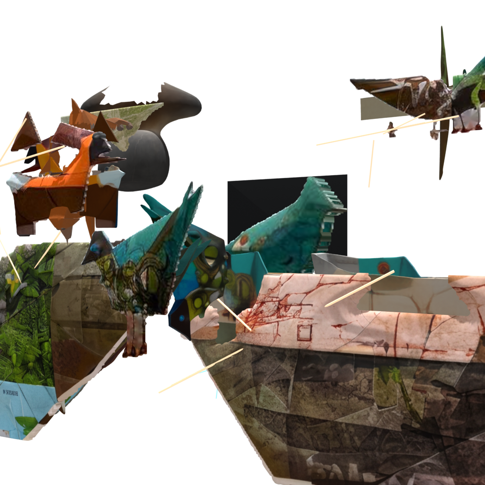
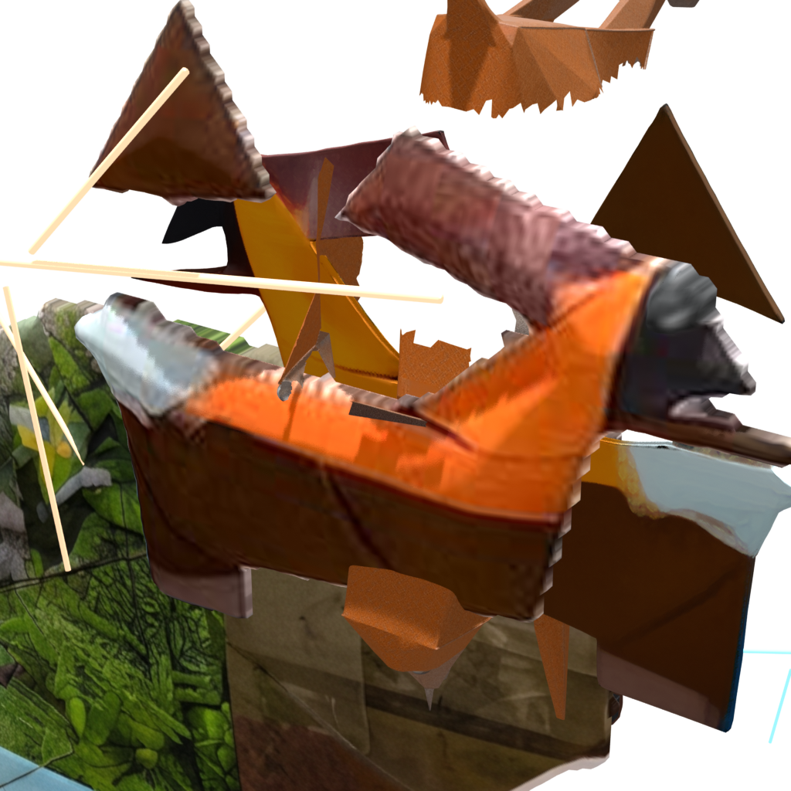

# Gonduras Meat Market (GMM) — The Multi-Model Assemblage

### Official Entry for the Meta AI Global Developer Hackathon 2026 (Cerebral Valley)
**Track:** Indie Developer • **Theme:** Build for Your World / Push the Frontier  
**Artist & Sole Visual Authority:** Alexander Gonduras Jitomirsky (Tel Aviv & Johannesburg)

[-Watch%20Demo%20Reel-1DA1F2?logo=x)](https://x.com/gonduras/status/2118117805845590257)
[](https://x.com/gonduras/status/2118117805845590257)
[](meta-ai-hackathon-2026/frankenstein_assemblage_stage_v7.usda)
[](meta-ai-hackathon-2026/SUBMISSION_MANIFEST_v7_ADDENDUM.json)
[](#lineage--co-creation-acknowledgement)

---

<p align="center">
  
  <br>
  <em>Figure 1: The verified v7 Master Assemblage Stage — physical scanned cardstock on the surface, internal 3D volumetric planar facets, and docked copper puppet spars in the Void Theatre.</em>
</p>

---

## The Concept: 20 Years of Analog Collage Meets a Sovereign 12GB AI Factory

In multidisciplinary analog collage, an artwork is not a flat pixel grid: it is a tactile **assemblage** of disparate physical materials—heavy 350 gsm cotton rag cardstock, butcher anatomical diagrams, found newsprint, medium-format photographic prints, and bent copper wire—cut with scalpel and scissors by artist **Alexander Gonduras Jitomirsky** across Tel Aviv and Johannesburg.

Standard generative video diffusion models catastrophically fail when applied to physical collage:
1. **The 3.5-Second Video Collapse:** Autoregressive diffusion models hold paper texture for roughly 2.0 to 3.0 seconds. Past 3.5 seconds, sharp scissor cuts soften, halftone newsprint dissolves into airbrushed gradients, and physical paper melts into rubbery CGI plastic.
2. **The Ceramic Smoothing Trap:** Off-the-shelf 3D reconstruction algorithms interpret paper fibers and scissor seams as surface noise, smoothing them into glossy porcelain figurines.

### Our Solution: The Multi-Model Assemblage
Instead of treating AI as a monolithic black-box generator, our local factory uses specialized AI models as computational craftsmen reading the artist's work from distinct spatial perspectives:
- **Meta SAM-3.1 & SAM-3D Objects:** Segmented organic cut contours and quarried internal volumetric masses.
- **Meshy:** Synthesized dense sculptural planar facets for creature bodies.
- **Meta `muse-spark-1.3`:** Acted as the spatial kinematic compiler, calculating exact matrix transformations, OpenUSD stages ([`frankenstein_assemblage_stage_v7.usda`](meta-ai-hackathon-2026/frankenstein_assemblage_stage_v7.usda)), and rigid 24fps hinge tables.
- **Meta `muse-wonder-1.0`:** Acted as theatrical director, color palette architect, and Void Theatre lighting designer.
- **GONVEX (Hermes & OpenCode DeepSeek v4.1 Flash):** Forensic accounting, provenance manifests, and frame-fingerprint measurement.
- **Codex-Astra & AGY (Gemini 4.0 Argon + 3.8 Flash):** Kinematic verification ([`attachment.js`](meta-ai-hackathon-2026/attachment.js)), Three.js WebGL spatial stage integration, and automated broadcast video assembly.

---

## Visual Proofs & Structural Architecture

<table align="center" width="100%">
  <tr>
    <th width="50%" align="center">Front (0°) — Solid Analog Collage Cardstock</th>
    <th width="50%" align="center">Oblique (32°) — Internal Copper Puppet Wireframe</th>
  </tr>
  <tr>
    <td>
      
    </td>
    <td>
      
    </td>
  </tr>
  <tr>
    <td align="center"><em>100% authoritative archival paper scan (+Y). No texture warp or hallucinated redraw.</em></td>
    <td align="center"><em>Reveals the 21 copper puppet spars docked at Z = -0.006m supporting the physical relief.</em></td>
  </tr>
</table>

### 1. Solid Opaque Paper Collage with Internal Copper Spars
- The front skin (+Y) of every creature is 100% the authoritative, high-resolution physical paper scan from Alexander's layered PSD.
- To prevent surface mesh distortion, **21 copper wireframe spars** (`#f4a261` birds, `#4cc9f0` cliffs) are docked strictly *behind* the paper faces ($Z = -0.006\text{ m}$), acting as skeletal supports. From the front (0°), you see pure analog collage; as the stage orbits to 32°, the glowing copper puppet skeleton is revealed.
- Color fidelity verified: `Standard` view transform and texture-driven emission maintain $\Delta E < 5$ against the archival scans.

### 2. Kinematic Beak Clamp (`attachment.js`)
Zero hallucinated physics. In the artwork, the orange bird grips a wriggling fish by its tail in its beak:

<p align="center">
  
  <br>
  <em>Figure 2: Macro close-up of the mechanical clamp between the orange bird's scissor-cut beak and the wriggling fish tail.</em>
</p>

- Our custom [`attachment.js`](meta-ai-hackathon-2026/attachment.js) solves child-mesh parent inverses in Three.js without quaternion degradation.
- Clamps the moving beak to the wriggling fish tail across independent transform hierarchies with floating-point precision (worst measured error $< 7 \times 10^{-16}\text{ m}$).
- 5 collage eyelids blink on prime-seeded asynchronous rhythms while flock gaze tracks the wriggling fish.

### 3. Deep 3-Plane Parallax Stage
- **Deep Sky ($Z = -0.220\text{ m}$):** Clean atmospheric background, eliminating clipping and ghosting.
- **Midground Cliffs ($Z = -0.075\text{ m}$):** Structural cardstock rock strata with cyan architectural wireframe spars.
- **Foreground Birds ($Z = 0.000\text{ m}$):** The flock of asymmetrical cut-paper birds and fish.

---

## System Architecture & The 12GB Zero-Overlap Local Factory

The entire pipeline was engineered and executed on a single consumer workstation equipped with an **NVIDIA GeForce RTX 3060 12GB**:

```
 ┌────────────────────────────────────────────────────────────────────────┐
 │                    ALEXANDER GONDURAS JITOMIRSKY                       │
 │                    (Sole Visual Ground Truth)                          │
 └──────────────────────────────────┬─────────────────────────────────────┘
                                    │ Directives & Evaluation
                                    ▼
 ┌────────────────────────────────────────────────────────────────────────┐
 │                      THE GMM AGENT COUNCIL                             │
 │  ┌─────────────────┐   ┌─────────────────┐   ┌──────────────────────┐  │
 │  │  GONVEX/Hermes  │   │  Codex (Astra)  │   │    AGY (Gemini)      │  │
 │  │ Provenance/Law  │   │ Math/Kinematics │   │ Assembly/Integration │  │
 │  └────────┬────────┘   └────────┬────────┘   └──────────┬───────────┘  │
 └───────────┼─────────────────────┼───────────────────────┼──────────────┘
             ▼                     ▼                       ▼
 ┌────────────────────────────────────────────────────────────────────────┐
 │                      THE META AI SPATIAL SUITE                         │
 │  ┌───────────────────────┐   ┌──────────────────────────────────────┐  │
 │  │    Meta SAM-3.1       │   │         Meta Muse Suite              │  │
 │  │ Volumetric Segmentation│  │ Spark 1.3 (USD) + Wonder 1.0 (Color) │  │
 │  └───────────────────────┘   └──────────────────────────────────────┘  │
 └──────────────────────────────────┬─────────────────────────────────────┘
                                    ▼
 ┌────────────────────────────────────────────────────────────────────────┐
 │             SOVEREIGN HARDWARE RUNTIME (NVIDIA RTX 3060 12GB)          │
 │  • Zero-Overlap VRAM Protocol: One Heavy Tenant at a Time              │
 │  • OpenUSD Stage Compilation (frankenstein_assemblage_stage_v7.usda)   │
 │  • Three.js WebGL Kinematic Attachment Engine (attachment.js)          │
 │  • FFmpeg 24fps Broadcast Assembly (SHA-256 Hash-Locked Manifests)     │
 └────────────────────────────────────────────────────────────────────────┘
```

---

## Demo Video & Hackathon Deliverables

- **Live Announcement & Demo Reel on X:** [https://x.com/gonduras/status/2118117805845590257](https://x.com/gonduras/status/2118117805845590257)
- **Master Broadcast Demo Reel:** `GMM_META_HACKATHON_DEMO_v4_v7hero.mp4` (94.07s @ 1080p 30fps, 69 MB, SHA-256 `e946a0cf62775429311dc5c9e987a3990812327d2b353ea48c27768440946f99`)
- **OpenUSD Master Stage:** [`meta-ai-hackathon-2026/frankenstein_assemblage_stage_v7.usda`](meta-ai-hackathon-2026/frankenstein_assemblage_stage_v7.usda)
- **Kinematic Solver:** [`meta-ai-hackathon-2026/attachment.js`](meta-ai-hackathon-2026/attachment.js)
- **Verified Cryptographic Manifests:**
  - [`meta-ai-hackathon-2026/SUBMISSION_MANIFEST_v7_ADDENDUM.json`](meta-ai-hackathon-2026/SUBMISSION_MANIFEST_v7_ADDENDUM.json) (9 entries, 149 MB)
  - [`meta-ai-hackathon-2026/SUBMISSION_MANIFEST_vv2.json`](meta-ai-hackathon-2026/SUBMISSION_MANIFEST_vv2.json) (44 entries, 2.74 GB)

---

## Lineage & Co-Creation Acknowledgement
- **Artist & Sole Visual Authority:** Alexander Gonduras Jitomirsky
- **Co-Architects & Law of Lineage:** GONVEX (Hermes & OpenCode DeepSeek v4.1 Flash) with `muse-wonder-1.0`
- **Spatial Workbench & Assemblage Integration:** AGY (Gemini 4.0 Argon + 3.8 Flash)
- **Kinematic Verification & Mathematical Rigor:** Codex (`codex-astra`)
- **Spatial Compiler & 3D Toolpath Execution:** Muse CLI (`muse-spark-1.3`)
- **Theatrical Director & Solution Architect:** `muse-wonder-1.0`
- **Volumetric Quarry:** Meta `sam-3.1` / `SAM-3D Objects` + Meshy
- **Local Factory:** Sovereign NVIDIA GeForce RTX 3060 12GB VRAM (Windows + WSL)
